# Evidencias de pruebas – ATM Challenge

## 1. Introducción

Este documento presenta las evidencias de las pruebas realizadas para validar el funcionamiento del sistema ATM.

## 2. Pruebas funcionales
Para realizar las pruebas previamente se levanta el servidor.

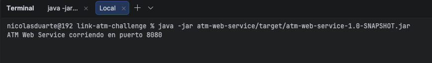

El resto de los comandos de ejecución se realizan sobre otras terminales. Los datos pre cargados se encuentran en `ATMRepository`

### 2.1.1 Login exitoso
**Objetivo:** Validar que se pueda hacer login al sistema con una tarjeta válida.

**Resultado esperado:** La operación se completa correctamente y se muestra el mensaje "Ingreso exitoso" por pantalla.

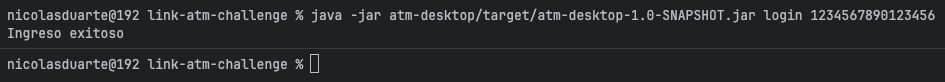

### 2.1.2 Login fallido
**Objetivo:** Validar que se al hacer login al sistema con una tarjeta inválida el sistema muestre un mensaje de error.

**Resultado esperado:** La operación falla y se muestra el mensaje "Ingreso no exitoso" por pantalla.

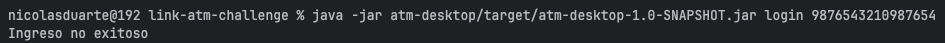

### 2.2.1 Consulta de saldo exitosa

**Objetivo:** Validar que se pueda realizar una consulta de saldo de una cuenta y tarjeta válida

**Resultado esperado:** La operación se completa correctamente y se muestra el saldo por pantalla.

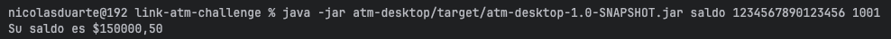

### 2.2.2 Consulta de saldo fallida

**Objetivo:** Validar que cuando se consulta el saldo de una cuenta con una tarjeta inválida de error.

**Resultado esperado:** La operación falla y se muestra "Tarjeta inactiva" por pantalla.

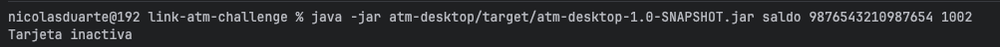

### 2.3.1 Extracción exitosa

**Objetivo:** Validar que se pueda realizar una extracción cuando la cuenta dispone de fondos suficientes.

**Resultado esperado:** La operación se completa correctamente y el saldo se actualiza.

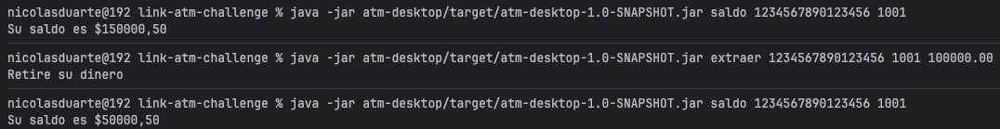

### 2.3.2 Extracción fallida por saldo insuficiente

**Objetivo:** Validar que el sistema rechace una extracción
que supera el saldo disponible.

**Resultado esperado:** La operación es rechazada y
el saldo permanece sin modificaciones.

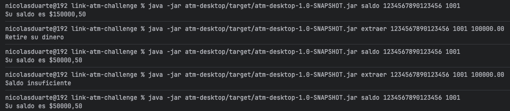

### 2.4.1 Depósito exitoso

**Objetivo:** Validar que se pueda realizar una depósito con una tarjeta y un CBU.

**Resultado esperado:** La operación se completa correctamente y el saldo se actualiza.

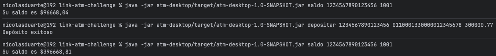

### 2.4.2 Depósito fallido

**Objetivo:** Validar que no se pueda realizar una depósito con una CBU inválido.

**Resultado esperado:** La operación se completa correctamente y el saldo se actualiza.

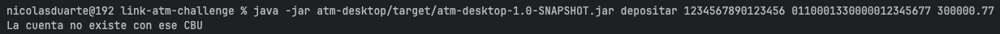

## 3. Pruebas de idempotencia

### 3.1 Repetición de una solicitud

**Objetivo:** Validar que una solicitud repetida no
produzca una segunda extracción.

**Resultado esperado:** Se realiza una extracción con una idempotency key y luego se vuelve a realizar la misma operación con la misma key, por lo que al revisar el saldo se puede constatar que solo se realizó una extracción.

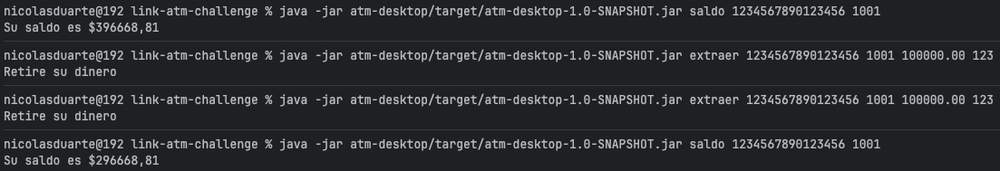

### 3.2 Reutilización de key con diferente payload

**Objetivo:** Validar que una solicitud que reutiliza una key de error si su contenido es diferente al request anterior.

**Resultado esperado:** Se realiza una extracción con una idempotency key y luego se vuelve a realizar la misma operación con la misma key, por lo que al revisar el saldo se puede constatar que solo se realizó una extracción.

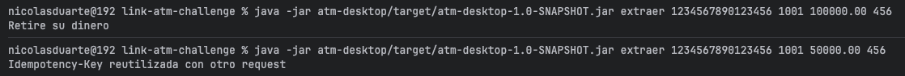

## 4. Registro de transacciones

### 4.1. Generación de logs

**Objetivo:** Verificar que las transacciones realizadas
queden registradas en el archivo CSV.

**Resultado esperado:** En el directorio raíz se genera un archivo .csv con los datos de las operaciones realizadas.

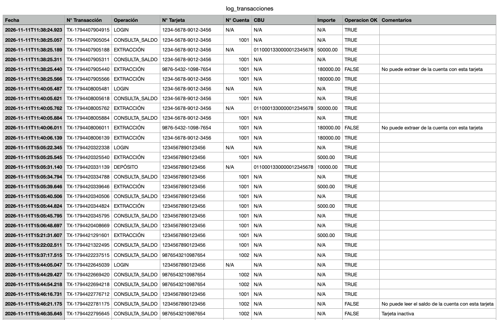